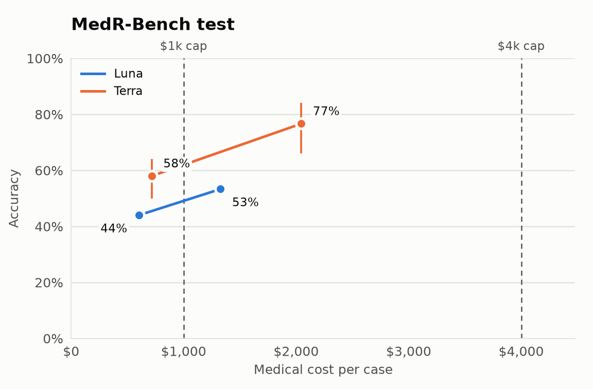
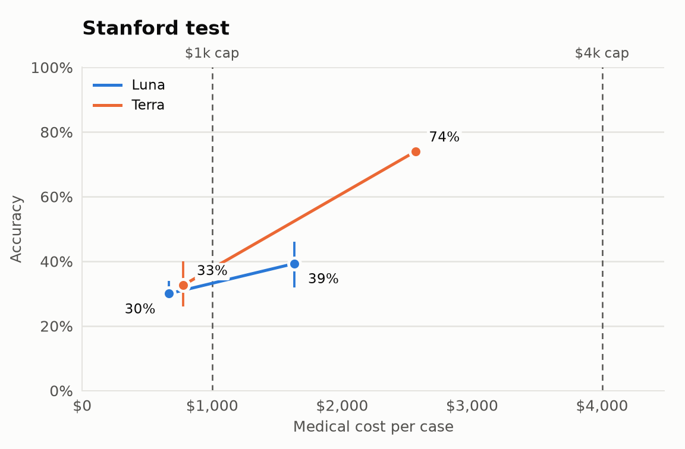
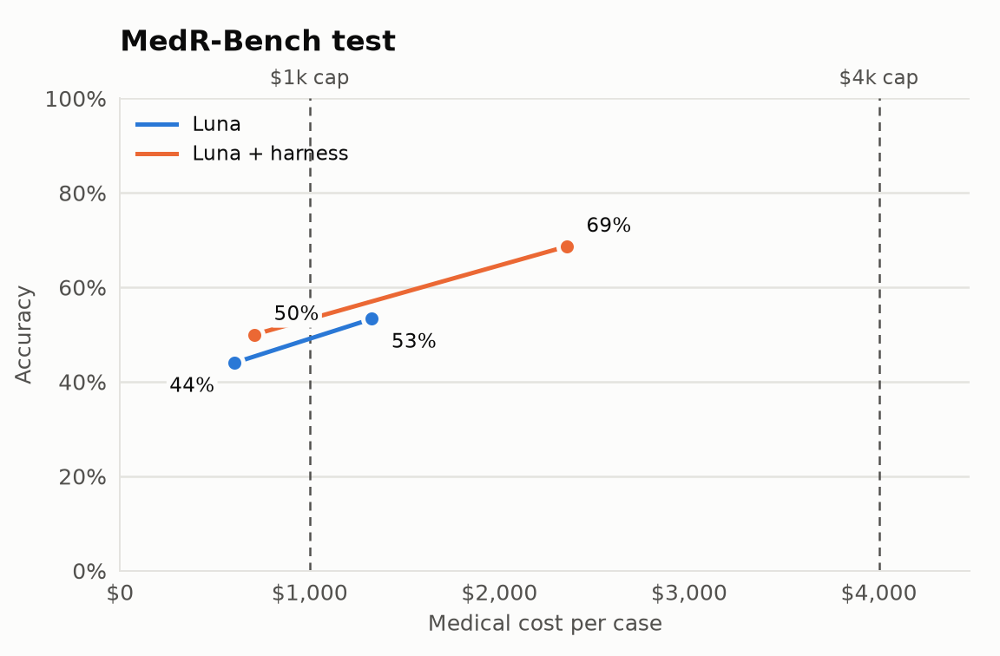
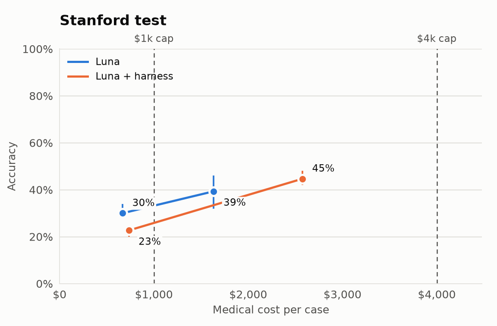

# Sequential diagnosis: harness engineering for a cheap model

Diagnosis is sequential: a clinician starts from a short complaint, asks questions, orders
tests, and stops when the evidence is enough. Microsoft's
[SDBench](https://github.com/microsoft/sdbench) evaluates models this way, but its real cases
need an NEJM license or credentialed MIMIC access. Only five synthetic cases are open.

This project has three parts:

1. **Data pipeline.** Turns published case reports into 200 SDBench-format cases
   ([benchmark/](benchmark/README.md)). One model writes each case, code checks every quote
   against the source and for leaks, and two independent model reviewers must accept it.
2. **Evaluation environment.** SDBench's agent loop, judge and hospital prices, with an
   evidence-only gatekeeper and enforced budget modes. Each result reports its run-to-run range.
3. **Agent harnesses.** Asks what makes a cheap model (GPT-6 Luna) diagnose better at the same
   medical budget: multi-agent teams following Kim et al. (2025), then an evidence-first harness
   with retrieved experience. The harness was built on development cases, chosen on validation,
   and tested once on the held-out cases.

## Results

Plots: held-out test sets (50 cases each), mean of 3 runs, bars = lowest and highest run.

### 1. Baselines: a stronger model is much better

<p>
  
  
</p>

GPT-6.1 Terra spends the larger budget on tests; GPT-6 Luna diagnoses early.

### 2. Validation: choosing a harness for GPT-6 Luna

All designs use GPT-6 Luna. The first four build on each other; the panel teams split the work
across agents. One run each on 40 validation cases (Luna alone: mean of 3 runs).

| Design | What it does | $1,000 | $4,000 |
| --- | --- | ---: | ---: |
| Luna alone | One model call per turn decides: ask, test or diagnose | 32.5% | 55.0% |
| Evidence-first | A second call checks the evidence before it may diagnose; at the end it weighs every diagnosis it considered | 27.5% | 47.5% |
| + playbook | Also reads 7 general rules learned from its mistakes on 60 development cases | 32.5% | 57.5% |
| **+ playbook + memory** | **Also reads the 3 most similar development cases and their lessons** | **37.5%** | **62.5%** |
| Panel team | 5 role agents: one ranks diagnoses, one picks tests, one checks cost, a lead decides, one challenges | 32.5% | 45.0% |
| Panel team + memory | The same, plus an agent that reads the similar past cases | 25.0% | 52.5% |

Only the bold design beat Luna at both budgets, so only it was tested
([details](results/evidence-validation/NOTES.md)).

### 3. Test: the harness works at $4,000

<p>
  
  
</p>

At $4,000 the harness gains +15.3 points on MedR-Bench (p = 0.007) and +5.3 on Stanford
(p = 0.32, not significant); at $1,000 it does not help. Multi-agent teams (6 designs) stayed
within ±3 points of Luna ([details](results/multi-agent-test/NOTES.md)).

## Reproduce

Requires [uv](https://docs.astral.sh/uv/).

```sh
python3 experiments/recompute_report.py   # recompute every reported number (no API key)
uv run --locked tests/run_offline.py      # offline tests
python3 experiments/run_arms.py experiments/specs/evidence_memory_test.json   # rerun the final test
```

Rerunning needs `OPENAI_API_KEY` in `.env` and SDBench's
[hospital price list](https://github.com/microsoft/sdbench/blob/main/data/costing_data/README.md)
in `data/costing_data/`.

## Data and licensing

The code is under the [MIT License](LICENSE). The 200 cases in `benchmark/` are under
[CC BY-SA 4.0](benchmark/LICENSE): they are adapted from CC BY articles in PubMed Central (each
listed in `benchmark/cases.csv`, to be credited) via MedCaseReasoning (MIT) and MedR-Bench
(CC BY-SA, whose share-alike term carries over). Raw run traces (about 1 GB), source downloads
and the hospital price list live in `data/`, which is not in the repository;
`results/*/cases.csv` keeps what the reports need. This project builds on
Microsoft's open-source SDBench and is not affiliated with Microsoft.

## Limitations

- **Small benchmark.** 100 held-out cases can't confirm gains under about 10 points. A 4-point
  gain needs about 580 cases.
- **No clinician review.** Cases were checked by AI reviewers and manual audits, but no
  physician has reviewed them or the grading.
- **One judge.** GPT-6 Luna grades every answer, including its own when it is the agent.
- **Not comparable to SDBench's published numbers.** The gatekeeper releases only findings
  stored for the case (SDBench's can synthesize results for undocumented tests), and the models,
  turn limits and budget modes differ.

## References

This project builds on SDBench and on two datasets of published case reports; the team designs
follow Kim et al. If you use the benchmark, please cite the datasets and SDBench:

- **MedCaseReasoning** (development, validation and Stanford test cases): K. Wu, E. Wu,
  R. Thapa, et al. *MedCaseReasoning: Evaluating and learning diagnostic reasoning from clinical
  case reports.* arXiv:2505.11733, 2025.
- **MedR-Bench** (external test cases): P. Qiu, C. Wu, S. Liu, et al. *Quantifying the reasoning
  abilities of LLMs on real-world clinical cases.* Nature Communications 16, 2025.
  doi:10.1038/s41467-025-64769-1 (arXiv:2503.04691).
- **SDBench** (evaluation environment): H. Nori et al. *Sequential diagnosis with language
  models.* arXiv:2506.22405, 2025.
- **Multi-agent architectures** (the team designs): Y. Kim et al. *Towards a science of scaling
  agent systems.* arXiv:2512.08296, 2025.

Each case also derives from one case report; cite the article in `benchmark/cases.csv` when you
use an individual case.
