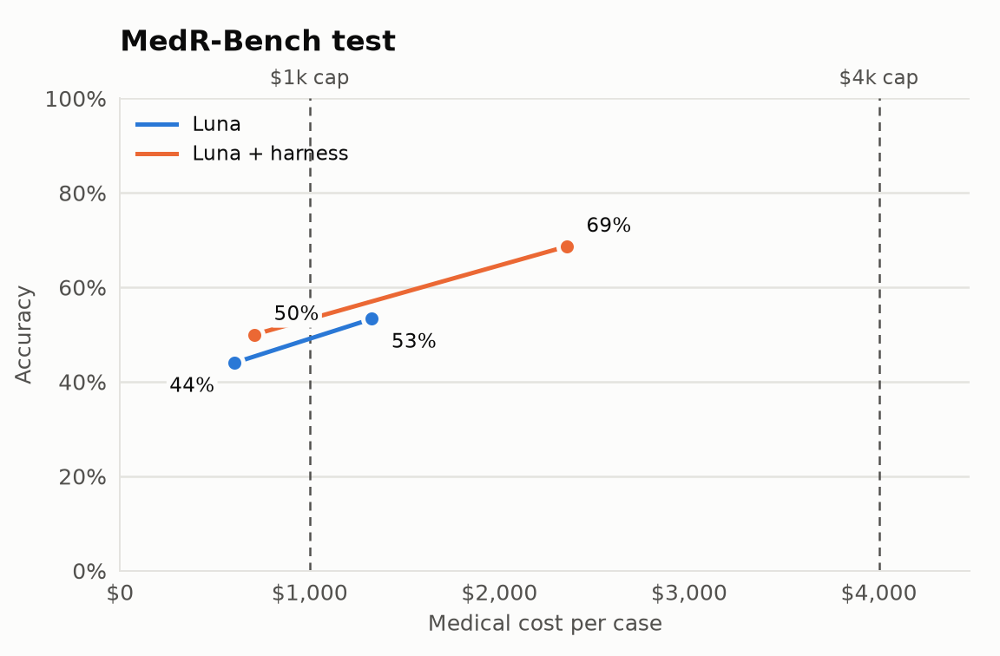
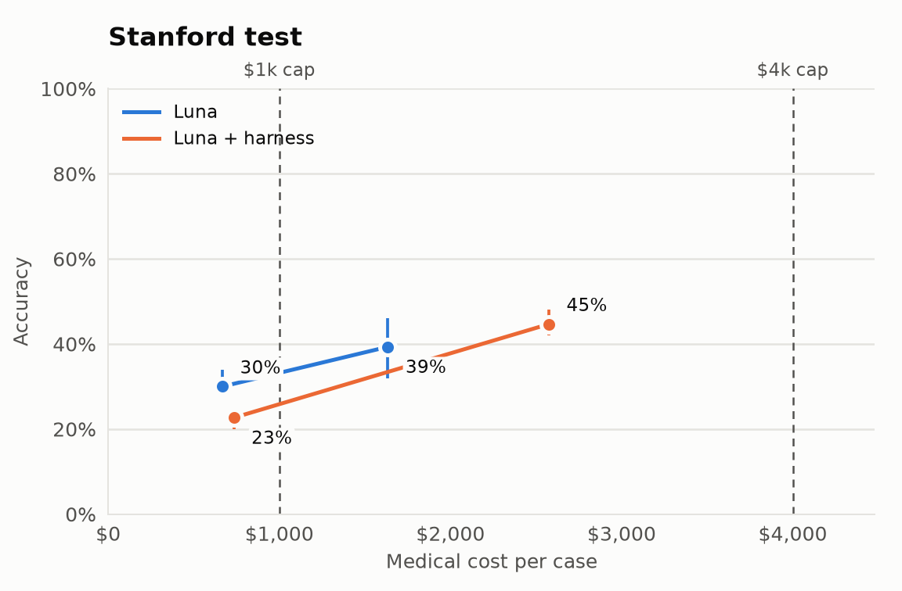

# Final held-out test: evidence-first agent with memory (GPT-6 Luna, 100 cases)

The frozen design chosen on validation (`evidence_memory`):
one GPT-6 Luna agent with case state, a closure gate, final reconciliation over every diagnosis it
considered, 7 playbook rules, and 3 retrieved lesson cards from the 60 development cases. Tested
once, 3 runs per test split and budget, against the 3 existing runs of single GPT-6 Luna.
All 12 runs finished without errors or resumes.

| Mode | Split | Single Luna | Harness | Change | p |
| --- | --- | ---: | ---: | ---: | ---: |
| $1,000 | Stanford test | 30.0% | 22.7% | −7.3 | 0.23 |
| $1,000 | MedR-Bench test | 44.0% | 50.0% | +6.0 | 0.25 |
| $1,000 | pooled | 37.0% | 36.3% | −0.7 (95% CI −7.7 to +6.3) | 0.93 |
| $4,000 | Stanford test | 39.3% | 44.7% | +5.3 | 0.32 |
| $4,000 | MedR-Bench test | 53.3% | **68.7%** | **+15.3** | 0.01 |
| $4,000 | pooled | 46.3% | **56.7%** | **+10.3 (95% CI +3.7 to +17.0)** | **0.01** |

 

## Reading

- **At $4,000 the harness works.** +10.3 points pooled (p = 0.01), positive on both test splits.
  It is the largest gain of any change to GPT-6 Luna in this project; the earlier best was the
  panel prompt (+6.3).
- **At $1,000 it does not.** The pooled change is −0.7, with opposite signs on the two splits.
  Its tools (more evidence before stopping, reconsidering every candidate) need budget to act on.
- **It buys more evidence.** Average medical cost at $4,000 rose from $1,328–1,634 to
  $2,355–2,575 per case, still well under the cap. Model cost rose from 0.1¢ to about 1.2¢ per
  case.
- **Validation predicted it.** On validation this arm was the only one above single Luna at both
  budgets (+5.0, +7.5 with one run). The arms that failed there (reconciliation alone, playbook
  alone, both panel teams) are in `results/evidence-validation/`.

## Limits

- 100 held-out cases and 3 runs: the interval is wide (+3.7 to +17.0).
- The validation choice used one run per arm; the planned confirmation runs were skipped.
- One judge (GPT-6 Luna), no physician review. Memory comes from 60 development cases only.
