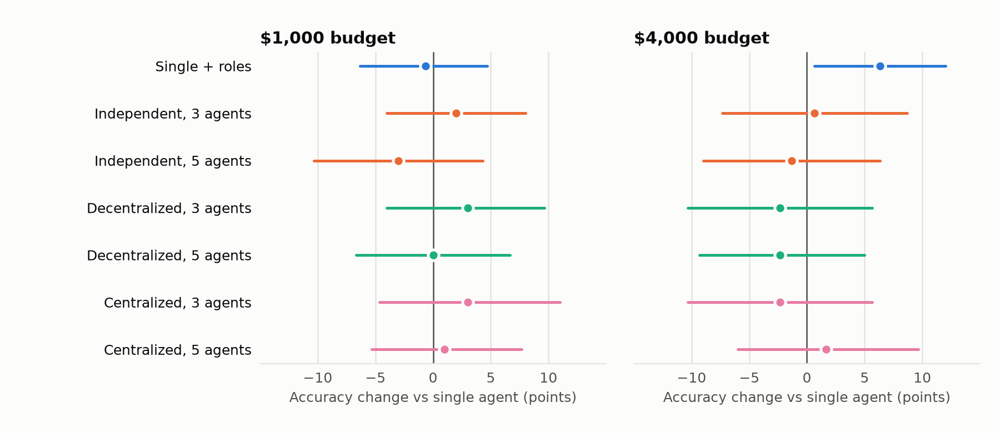

# Multi-agent designs vs a single agent (GPT-6 Luna, held-out, 100 cases)

Three architectures from Kim et al. (2025), each with 3 and 5 agents, on one shared encounter per
case (one action per turn). Every agent, referee and orchestrator is GPT-6 Luna at medium
reasoning. Team arms ran once per test split and mode; the single agent and "single + roles" (the
panel prompt) have three runs each, from `panel-test`.

| Arm | $1,000: change (95% CI) | $4,000: change (95% CI) | Model cost per case |
| --- | --- | --- | ---: |
| Single (baseline accuracy) | 37.0% | 46.3% | 0.13¢ |
| Single + roles | −0.7 (−6.3 to +4.7) | **+6.3 (+0.7 to +12.0)** | 0.21¢ |
| Independent, 3 | +2.0 (−4.0 to +8.0) | +0.7 (−7.3 to +8.7) | 0.41¢ |
| Independent, 5 | −3.0 (−10.3 to +4.3) | −1.3 (−9.0 to +6.3) | 0.65¢ |
| Decentralized, 3 | +3.0 (−4.0 to +9.7) | −2.3 (−10.3 to +5.7) | 0.55¢ |
| Decentralized, 5 | 0.0 (−6.7 to +6.7) | −2.3 (−9.3 to +5.0) | 0.9¢ |
| Centralized, 3 | +3.0 (−4.7 to +11.0) | −2.3 (−10.3 to +5.7) | 0.8¢ |
| Centralized, 5 | +1.0 (−5.3 to +7.7) | +1.7 (−6.0 to +9.7) | 1.2¢ |

Changes are in accuracy points, pooled over both test splits, with a sign-flip p-value and a
bootstrap interval per arm. Model cost is the average over the two modes and splits.

## Findings

- **No team design beats the single agent.** All six team arms are within ±3 points in both
  modes. The smallest pooled p-value is 0.45, so nothing survives the Holm correction, and no arm
  has the same sign of gain on both splits in both modes.
- **More agents do not help.** Going from 3 to 5 agents changed accuracy by −5 to +4 points
  within each design, with no consistent direction, while model calls rose by about 50–80%.
- **Teams cost 3–9 times as much in model tokens** (0.4–1.2¢ per case against 0.13¢) at the same
  medical cost. Centralized teams took more turns and spent slightly more on tests.
- **Roles in one prompt did better than roles in separate agents.** "Single + roles" is the only
  arm with a significant gain (+6.3 at $4,000, p = 0.04, 3 runs). Splitting the same roles into
  agents (Centralized) did not reproduce it.
- **The 45% threshold prediction was not confirmed.** Kim et al. predict team gains when a single
  agent scores below about 45%. GPT-6 Luna is below that at $1,000 (37%), yet the team changes
  there (−3 to +3) are within noise.

These results match Kim et al.'s finding for sequential tasks (PlanCraft), where every
multi-agent variant underperformed a single agent: each step depends on the last, so splitting
the work adds coordination without adding information.

## Why the teams did not help

`experiments/analyze_teams.py` grades every diagnosis that any team member proposed on the final
turn, using that encounter's own judge prompt with only the candidate swapped (1,309 extra judge
calls, cached in `data/analysis/`). Results per 100 encounters:

| Arm | $1,000: team correct | a member had a correct one | nobody had one | $4,000: team correct | a member had one | nobody had one |
| --- | ---: | ---: | ---: | ---: | ---: | ---: |
| Independent 3 | 39 | 40 | 60 | 47 | 51 | 49 |
| Independent 5 | 34 | 44 | 56 | 45 | 53 | 47 |
| Decentralized 3 | 40 | 45 | 55 | 44 | 46 | 54 |
| Decentralized 5 | 37 | 39 | 61 | 44 | 47 | 53 |
| Centralized 3 | 40 | 42 | 58 | 44 | 46 | 54 |
| Centralized 5 | 38 | 40 | 60 | 48 | 55 | 45 |

1. **Generation is the bottleneck, not selection.** In 45–61% of encounters no member proposed a
   correct diagnosis. Perfect selection would add only 1–10 cases. Better voting or a better
   orchestrator cannot fix a team whose members all miss the answer.
2. **Members share one encounter, so they share one body of evidence.** Every member reads the
   same questions and test results, so their proposals converge. A single agent run three times
   on the same case, each run collecting its own evidence, is correct in at least one run in 50
   of 100 cases at $1,000 and 65 at $4,000, far above any team's "a member had it" (39–55).
   Diversity comes from different evidence paths, not from more opinions on the same evidence.
   This is why MAI-DxO's ensemble, which runs whole diagnoses independently and pays for every
   test, gained accuracy while our shared-encounter teams did not.
3. **Members follow the majority, not themselves.** Decentralized voters chose their own proposal
   25% of the time, close to chance for 3–5 proposals; votes converged on the common option. When
   some Decentralized members wanted to diagnose and others to test, the team diagnosed in 125 of
   267 such turns. Centralized orchestrators copied one member's action word for word in 49% of
   turns, spread evenly across roles, and otherwise merged them.
4. **Teams did not change how much evidence was bought.** Average spend and distinct tests stayed
   close to the single agent's at both budgets. GPT-6.1 Terra, by contrast, spent about $2,300 at
   $4,000 and gained 29 points. At $4,000, 20 cases were solved by no GPT-6 Luna arrangement
   (single, panel prompt or any team) in any run; Terra solved 13 of them, so the evidence was
   there to find.

**What would be needed for a team to help:** members that bring different knowledge or collect
different evidence. Candidates are a mixed-model team (GPT-6 Luna with GPT-6.1 Terra), members
that follow separate testing paths before a final vote (at a higher medical cost, as in MAI-DxO's
ensemble), or roles with tools the single agent lacks.

## Limits

- Team arms have one run each. With about 1 grade in 4 changing between runs, differences under
  about 10 points cannot be confirmed, and the intervals above are wide.
- 100 held-out cases, one judge (GPT-6 Luna), no physician review.

## Resumed cases

A network outage around 17:20 made three cases fail all three automatic attempts. They were rerun
once the connection returned: `same_source_test/budget_4000/independent_3` PMC9976724 and
`external_test/budget_4000/independent_5` PMC11415135 and PMC11551029.

Reproduce: `python3 experiments/run_arms.py experiments/specs/multi_agent_test.json`, then `uv
run experiments/plots.py designs results/multi-agent-test/report.json`.
